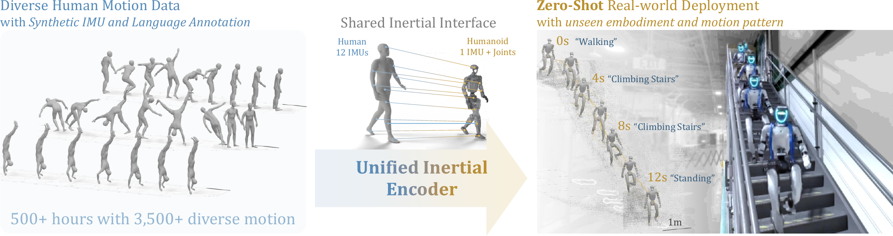
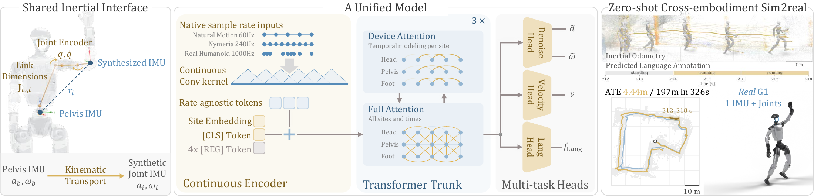

# <div align="center">A Unified Inertial Encoder for Human and Humanoid Motion</div>

<p align="center">
  <a href="https://unified-inertial-encoder.github.io/"></a>
  
  <a href="LICENSE"></a>
</p>

<p align="center">
  
</p>

<p align="center"><em>
One encoder, trained on human motion and kinematically retargeted G1 motion, transfers zero-shot
to a physical Unitree G1 without physics simulation, real-robot training trajectories, or
fine-tuning. It reaches the lowest velocity error among the evaluated methods on all five
datasets, including 0.099 m/s on the real G1.
</em></p>

This repository contains model training, baseline comparisons, data preprocessing, evaluation, and
the paper's analyses.

## 🔥 Updates

* [Nov 2026] Initial code release: training, baselines, preprocessing, and evaluation.

## 💡 Method Overview

<p align="center">
  
</p>

* **Shared inertial interface.** Twelve corresponding body sites connect human and humanoid motion:
  pelvis, head, and bilateral upper arms, forearms, upper legs, lower legs, and feet. On the G1,
  kinematic IMU synthesis derives these streams from the pelvis IMU, measured joint positions and
  velocities, and link kinematics. It needs no world pose or root velocity.
* **Continuous-time encoding.** A timestamp-aware tokenizer handles different sampling rates,
  irregular timing, and missing samples without resampling. Each token covers a fixed 125 ms of
  motion rather than a fixed number of samples.
* **Alternating attention trunk.** Six transformer blocks of width 768 alternate between per-device
  and full attention. The decoder heads read from blocks 1, 3, and 5.
* **Joint multi-task training.** A single stage trains on human and retargeted G1 motion with
  velocity, motion–text alignment, denoising, and trajectory objectives.
* **Sensor and motion randomization.** Noise, bias drift, structural vibration, foot impacts, and
  timing perturbations stand in for the hardware effects that kinematic data omits.

## 🔧 Minimum Requirements

| Component | Requirement | Notes |
|---|---|---|
| **Python** | 3.14 | The version used by CI |
| **PyTorch** | Not pinned | Install the build that matches your hardware |
| **GPU** | CUDA GPU for evaluation | The paper model was trained on 8 GPUs at 128 windows per GPU |
| **FlashAttention** | Optional | The model falls back to SDPA |
| **TensorRT** | Optional | Only for TensorRT profiling |
| **ffmpeg** | Optional | Only for video rendering, must be on `PATH` |

## 📦 Installation & Environment

1. **Clone the repository**

    ```bash
    git clone --recursive https://github.com/unified-inertial-encoder/Unified-Inertial-Encoder.git
    cd Unified-Inertial-Encoder
    ```

2. **Create an environment and install the dependencies**

    ```bash
    python3.14 -m venv .venv
    . .venv/bin/activate
    python -m pip install torch  # choose the build for your hardware
    python -m pip install -r requirements.txt
    ```

The baselines and robot assets are git submodules, and each keeps its upstream license. The
network used by the *AirIO w/ joints* baseline is vendored under `thirdparty/IMUnet`.

### Paths and Logging

All data and outputs resolve through three roots. The values below are the defaults, and relative
values resolve against the repository root, independently of Hydra's working directory:

```bash
export FOUNDATIONIMU_DATA_ROOT="$PWD/data"         # raw datasets
export FOUNDATIONIMU_CACHE_ROOT="$PWD/data"        # processed caches and baseline weights
export FOUNDATIONIMU_EXP_ROOT="$PWD/experiments"   # training runs
```

Configs read these roots through `${machine-conf:data_root}`, `${machine-conf:cache_root}`, and
`${machine-conf:exp_root}`.

Training logs to W&B through `WANDB_API_KEY` or an existing SDK login, with an optional
`WANDB_ENTITY`. Pass `wandb.enable=false` to turn logging off.

## 🗂️ Datasets

Obtain each dataset under its own access terms. Raw data and processed caches go in these
locations:

| Corpus | Embodiment | Rate | Hours | Language | Used for | Download | Under `$FOUNDATIONIMU_DATA_ROOT` | Under `$FOUNDATIONIMU_CACHE_ROOT` |
|---|---|---:|---:|:---:|---|---|---|---|
| Nymeria | Human | 240 Hz | 300+ | ✅ | Train + eval | **[Project Aria](https://facebookresearch.github.io/projectaria_tools/docs/open_datasets/dataset_explorer)** | `nymeria_imu` | `nymeria_imu_processed_v3` |
| Natural Motion | Human | 240 Hz | 40.6 | – | Train + eval | **[Virginia Tech](https://data.lib.vt.edu/articles/dataset/Virginia_Tech_Natural_Motion_Dataset/14114054)** | `vt_natural_motion/h5-dataset` | `vt_natural_motion_processed_v3` |
| BONES-Seed (SOMA) | Human | 120 Hz | 144 | ✅ | Train + eval | **[🤗 bones-studio/seed](https://huggingface.co/datasets/bones-studio/seed)** | `bones_seed` | `bones_seed_soma_processed_v4` |
| BONES-Seed (G1) | G1, retargeted | 120 Hz | 144 | ✅ | Train + eval | **[🤗 bones-studio/seed](https://huggingface.co/datasets/bones-studio/seed)** | `bones_seed` | `bones_seed_processed_v4` |
| Real G1 | G1, real IMU | 200 Hz | 0.7 | – | Eval only | **[🤗 humanoid-g1-odometry](https://huggingface.co/datasets/Open-IO/humanoid-g1-odometry)** | – | `humanoid_superodom_clips_v2` |

The train and validation splits are committed under `src/config/data/stems/` and use the official
dataset sequence IDs, so keep those IDs when you download. Nymeria needs a locally generated
catalogue; see the [download instructions](src/scripts/nymeria_imu_download/README.md), and keep
catalogues and credentials out of version control.

### Preprocessing

Every entrypoint takes a configuration and an output path, and `--help` lists its other options.

```bash
CACHE="$FOUNDATIONIMU_CACHE_ROOT"

python -m src.scripts.nymeria_imu_process src/config/data/nymeria_full_9imu.yaml "$CACHE/nymeria_imu_processed_v3"
python -m src.scripts.naturalmotion_imu_process src/config/data/naturalmotion_full_9imu.yaml "$CACHE/vt_natural_motion_processed_v3"
python -m src.scripts.bonesseed_soma_process src/config/data/bones_seed_soma_full.yaml "$CACHE/bones_seed_soma_processed_v4"
python -m src.scripts.bonesseed_imu_process src/config/data/bones_seed_full.yaml "$CACHE/bones_seed_processed_v4"
```

**Real G1.** The published clips are already processed, so download them straight into the cache:

```bash
python -m pip install huggingface_hub
hf download Open-IO/humanoid-g1-odometry --repo-type dataset --local-dir "$CACHE/humanoid_superodom_clips_v2"
```

**Language annotations.** Language-labelled training needs the Nymeria narration sidecars. The
transcription step calls an LLM through Amazon Bedrock, so it needs AWS credentials. The second
step encodes the phrases with CLIP into the IMU cache.

```bash
python -m src.scripts.nymeria_lang_transcribe --style motion-verb   # or --style bones
python -m src.scripts.nymeria_lang_process src/config/data/nymeria_full_9imu_mmap.yaml "$CACHE/nymeria_imu_processed_v3"
# For the BONES-style transcription, add --variant bones to the second command.
```

**Joint baselines.** The *AirIO w/ joints* baseline and the joint-input ablations read
root-IMU and joint caches, written to `$FOUNDATIONIMU_CACHE_ROOT/rootjoint_v1`:

```bash
python -m src.scripts.rootjoint_process all
```

## 🤗 Pretrained Checkpoint

The paper model is on Hugging Face at
**[🤗 Open-IO/Unified-Inertial-Encoder](https://huggingface.co/Open-IO/Unified-Inertial-Encoder)**.
Download it as a run directory, which the evaluation commands below use as `$RUN`:

```bash
RUN="${FOUNDATIONIMU_EXP_ROOT:-experiments}/unified-inertial-encoder"
hf download Open-IO/Unified-Inertial-Encoder --local-dir "$RUN"
```

The release holds the EMA weights in `checkpoints/unified_encoder.ckpt` and the training
configuration in `.hydra/`. It has no optimizer state, so to train from it, fine-tune with
`'meta.resume_from=<CKPT>' meta.resume_full_state=false`. To evaluate your own run instead, set
`RUN` to its directory and use a checkpoint from its `checkpoints/`.

## 🛠️ Reproducing the Paper

> [!NOTE]
>
> Raw data is not bundled with this repository. The commands below assume you have prepared the
> datasets, and have either downloaded the pretrained checkpoint or trained a model.

### Training

The paper model is the recipe `exp15_full_train_C`:

```bash
python -m src.train experiment=exp15_full_train_C
```

The recipe trains for 64 epochs, and the paper reports the EMA weights after 20 epochs (step 6420),
released as `unified_encoder.ckpt`. Real-G1 evaluation clips are never used for gradient training,
but their scores informed this checkpoint selection.

Each run writes to `$FOUNDATIONIMU_EXP_ROOT/<date>/<time>/`, with weights in `checkpoints/` and the
resolved configuration in `.hydra/`. Keep `.hydra` with the checkpoint, because evaluation uses it
to rebuild the model and data pipeline, including command-line overrides.

Useful overrides:

* `debug=true`: one device, no DDP, and no dataloader workers, so breakpoints work.
* `wandb.enable=false`: no W&B logging.
* `'meta.resume_from=<CKPT>'`: resume a run. Keep the single quotes so the `=` in the checkpoint
  name survives.

### Baselines

`<dataset>` is one of `nymeria`, `naturalmotion`, `bones_soma`, `bones_g1`, or `superodom`.

| Paper row | Train | Evaluate |
|---|---|---|
| TLIO | `python -m src.train_tlio experiment=exp9_tlio_baseline_<dataset>` | `src.eval_tlio` |
| AirIO | `python -m src.train_airio experiment=exp10_airio_<dataset>` | `src.eval_airio`, `src.eval_airio_ekf` |
| AirIMU | `python -m src.train_airimu experiment=exp13_airimu_<dataset>` | `src.eval_airimu` |
| AirIO w/ joints | `python -m src.train_airio --config-name train_airio_joints experiment=exp19_airio_joints_<dataset>` | `src.eval_airio_joints`, `src.eval_airio_joints_direct` |
| IMU2CLIP | `python -m src.train_imu2clip experiment=exp11_imu2clip_lang` | `src.scripts.evaluate_language_classification_imuclip` |
| TartanIMU | Released weights | `src.eval_tartanimu` |
| ImageBind | Released weights | `src.scripts.evaluate_language_classification_imagebind` |

TartanIMU and ImageBind weights go under `$FOUNDATIONIMU_CACHE_ROOT`. The headers of
[`src/config/model/tartanimu.yaml`](src/config/model/tartanimu.yaml) and
[`src/config/model/imagebind.yaml`](src/config/model/imagebind.yaml) give the expected locations.

### Ablations

Each ablation is a variant of `exp15_full_train_C`, launched with
`python -m src.train experiment=<recipe>`.

| Study | Recipes |
|---|---|
| Single pelvis IMU | `exp16_multiimu_pelvis` |
| Data scaling (1/4, 1/16, 1/64) | `exp17_scale_f4`, `exp17_scale_f16`, `exp17_scale_f64` |
| Model design | `exp18_arch_fullattn`, `exp18_arch_norope`, `exp18_arch_discrete` |
| Pelvis IMU + joints as input | `exp20_ablation_joint`, `exp21_ablation_joint_corrupt` |
| Model-size sweep | `exp22_scale_d{192,256,384,512,1024,1536}` |

`bash run.sh` runs the three model-design ablations in sequence. Set `FOUNDATIONIMU_PYTHON` to
choose its interpreter.

## 📏 Evaluation

**Odometry.** `src.eval_foundation` reports AVE, ATE<sub>GT</sub>, and ATE<sub>Pred</sub>. The model
runs on every sensor site of the dataset, then predictions and ground truth are restricted to the
pelvis so the numbers compare directly with the pelvis-only baselines.

```bash
python -m src.eval_foundation \
    --ckpt "$RUN/checkpoints/unified_encoder.ckpt" \
    --data_from "$RUN" \
    --dataset Humanoid_SuperOdom_NPZ_Processed_Language \
    --json real_g1.json
```

`--data_from` is a run directory whose `.hydra` config defines the validation pipelines. `--dataset`
selects one of them by reader class:

| Dataset | `--dataset` |
|---|---|
| Nymeria | `Nymeria_XSens_Processed_IMU_Language` |
| Natural Motion | `NaturalMotion_XSens_Processed_IMU_Language` |
| BONES-Seed (Human) | `Bones_Seed_SOMA_Processed_IMU_w_Lang` |
| BONES-Seed (G1) | `Bones_Seed_G1_Processed_IMU_w_Lang` |
| Real G1 | `Humanoid_SuperOdom_NPZ_Processed_Language` |

* **AVE**: average velocity error of the pelvis stream (m/s).
* **ATE<sub>GT</sub>**: trajectory error when integrating predicted body velocity with ground-truth
  rotation (m).
* **ATE<sub>Pred</sub>**: the same, with rotation preintegrated from the gyroscope, so no oracle
  attitude is used at test time (m).

**Language retrieval.** This command scores IMU-to-text and text-to-IMU retrieval on Nymeria and
BONES-Seed, including the G1 motion categories excluded from retargeted-G1 training. The checkpoint
path is absolute or relative to `$FOUNDATIONIMU_EXP_ROOT`.

```bash
python -m src.scripts.evaluate_language_classification "$RUN/checkpoints/unified_encoder.ckpt"
```

`--lang-variant` must match the Nymeria annotations the checkpoint was trained on: `bones` (the
default) reads `lang_spec.bones.json`, and `v1` reads `lang_spec.json`.

**Runtime.** Profiling uses a synthetic 12-IMU stream at 200 Hz for 4 s, so it needs no dataset,
only a trained checkpoint. Add `--trt` for the TensorRT deployment path in
`src/model/model_trt.py`.

```bash
python -m src.scripts.effiency_profiling --ckpt "$RUN/checkpoints/unified_encoder.ckpt" --device cuda:0 --trt
```

### Paper Analyses

| Output | Entrypoint |
|---|---|
| Generalization suite for velocity | `src.scripts.evaluate_velocity_generalization` |
| `[CLS]` t-SNE | `src.scripts.analyze_cls_tsne` |
| Scaling-law fit | `src.scripts.fit_scaling_law` |
| Baseline runtime and figure | `src.scripts.airio_profiling`, `src.scripts.tartanimu_profiling`, `src.scripts.visualize_runtime` |

`analyze_cls_tsne` takes `--ckpt`, and `fit_scaling_law` takes a `--runs` registry of your
`exp22_*` runs.

## 🗺️ Repository Structure

```
├── src/
│   ├── config/              # Hydra configs: data, model, loss, optim, experiment recipes
│   ├── data/                # Dataset readers, IMU synthesis, corruption transforms
│   ├── interface/           # Typed data containers and shared protocols
│   ├── model/               # FoundationIMU, tokenizer, trunk, TensorRT path, baseline adapters
│   ├── evaluate/            # Velocity and trajectory metrics
│   ├── scripts/             # Preprocessing, evaluation suites, analyses
│   ├── train.py             # Train the paper model (also train_{tlio,airio,airimu,imu2clip}.py)
│   ├── eval_foundation.py   # Paper odometry metrics (also eval_{tlio,airio,airimu,...}.py)
│   └── utility/             # Shared helpers
├── tests/                   # Baseline port and deployment checks
├── thirdparty/              # Baseline submodules and vendored IMUnet network
├── assets/                  # Unitree robot descriptions and README media
└── run.sh                   # Model-design ablation launcher
```

## 🧪 Development

```bash
PYTEST_DISABLE_PLUGIN_AUTOLOAD=1 python -m pytest tests
python -m pyright
```

Tests that need released checkpoints or TensorRT skip when those artifacts are unavailable.

## 🙏 Acknowledgements

This work builds on [AirIMU](https://github.com/haleqiu/AirIMU),
[AirIO](https://github.com/Air-IO/Air-IO), [TLIO](https://github.com/CathIAS/TLIO),
[IMU2CLIP](https://github.com/facebookresearch/imu2clip),
[ImageBind](https://github.com/facebookresearch/ImageBind),
[TartanIMU](https://github.com/superxslam/TartanIMU), and
[PyPose](https://github.com/pypose/pypose). We thank the
[Nymeria](https://facebookresearch.github.io/projectaria_tools/docs/open_datasets/dataset_explorer),
[Virginia Tech Natural Motion](https://data.lib.vt.edu/articles/dataset/Virginia_Tech_Natural_Motion_Dataset/14114054),
and [BONES-SEED](https://huggingface.co/datasets/bones-studio/seed) datasets, and
[SuperOdom](https://github.com/superxslam/SuperOdom) and
[MAC-VO](https://github.com/MAC-VO/MAC-VO), which we used as references on the real G1.

## 📝 Citation

If you find this work useful, please cite:

```bibtex
@misc{chen2026unifiedinertial,
  title={A Unified Inertial Encoder for Human and Humanoid Motion},
  author={Chen, Yutian and Zhao, Shibo and Duan, Rocky and Liu, Karen and
          Sferrazza, Carmelo and Shi, Guanya and Qiu, Yuheng and Sreenath, Koushil},
  year={2026},
  url={https://unified-inertial-encoder.github.io/}
}
```

## 📄 License

This code is released under the [Apache License 2.0](LICENSE). Third-party notices are in
[THIRD_PARTY_NOTICES.md](THIRD_PARTY_NOTICES.md).
